<h3><code>manyashri1901@github ~ $ ./contributions.sh</code></h3>

  

<h3><code>manyashri1901@github ~ $ whoami</code></h3>

  

<h3><code>manyashri1901@github ~ $ ls projects/</code></h3>
<table>
  <tr>
    <td></td>
    <td></td>
  </tr>
  <tr>
    <td></td>
    <td></td>
  </tr>
</table>

<a href="https://chainledger-fzob6wuevrvd5k69ylp25p.streamlit.app/"><code>▶ ChainLedger live dashboard</code></a>

  

<h3><code>manyashri1901@github ~ $ cat open-to.txt</code></h3>

 

<a href="https://linkedin.com/in/manya-shrivastava1901"><code>linkedin.com/in/manya-shrivastava1901</code></a>

